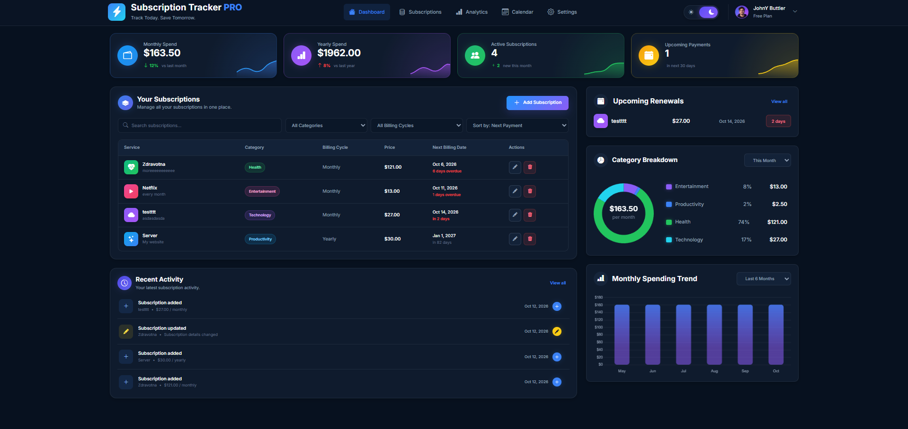

# 💳 Subscription Tracker PRO

A modern and responsive subscription management dashboard built with **HTML, CSS and Vanilla JavaScript**.

Subscription Tracker PRO allows users to manage recurring subscriptions, monitor monthly and yearly spending, track upcoming renewals and visualize subscription data through interactive charts.

The project focuses on practical JavaScript concepts such as **CRUD operations, array methods, localStorage, dynamic rendering, filtering, sorting, date calculations and data visualization**.

---

## 🔗 Live Demo

👉 **[Open Subscription Tracker PRO](https://johnyisbackk.github.io/js-subscription-tracker-pro-/)**

---

## 🖼️ Preview



---

## ✨ Features

### 💳 Subscription Management

- Add new subscriptions
- Edit existing subscriptions
- Delete subscriptions
- Store subscription name and description
- Choose subscription category
- Select monthly or yearly billing
- Set subscription price
- Set the next billing date
- Choose a service icon
- Dynamic subscription table rendering

### 🔍 Search, Filter & Sort

Subscriptions can be searched and organized directly from the dashboard.

Search subscriptions by:

- Service name
- Description
- Category

Filter subscriptions by:

- Category
- Billing cycle

Sort subscriptions by:

- Next payment
- Lowest price
- Highest price
- Name

Search, filters and sorting work together as one data pipeline.

### 📊 Dynamic Statistics

The dashboard automatically calculates:

- Monthly spending
- Yearly spending
- Number of active subscriptions
- Upcoming payments

Yearly subscriptions are converted into their monthly equivalent when calculating monthly spending.

Monthly subscriptions are converted into yearly totals when calculating yearly spending.

### 📅 Upcoming Renewals

Subscription Tracker PRO automatically detects upcoming payments.

Renewals are:

- Calculated from the next billing date
- Sorted from nearest to latest
- Limited to the closest upcoming subscriptions
- Highlighted when the payment date is approaching

### 🕒 Recent Activity

The application keeps track of subscription activity.

Activity events include:

- Subscription added
- Subscription updated
- Subscription removed
- Successful payments

Only the latest activity is displayed in the dashboard while the complete activity data remains stored in the application.

### 🍩 Category Breakdown

Subscription spending is automatically grouped into categories:

- Entertainment
- Productivity
- Health
- Technology

The dashboard calculates:

- Spending per category
- Percentage of total spending
- Monthly category totals
- Yearly category totals

The result is displayed using a dynamic **Chart.js doughnut chart**.

### 📈 Monthly Spending Trend

The application generates a visual spending overview for:

- Last 6 months
- Last 12 months

Monthly and yearly subscriptions are processed to calculate recurring spending data.

The results are displayed using an interactive **Chart.js bar chart**.

### 🌙 Dark & Light Mode

The interface supports both:

- Dark mode
- Light mode

The selected theme is saved in `localStorage`, so the application remembers the user's preference after refreshing or reopening the page.

Charts automatically refresh when the theme changes.

### 💾 Local Storage

Application data is stored directly in the browser using `localStorage`.

Stored data includes:

- Subscriptions
- Recent activity
- Selected theme

This allows the application to preserve data after the page is refreshed.

---

## ⚙️ How It Works

Subscription data is stored inside a JavaScript array.

Whenever the user adds, edits or deletes a subscription, the application:

1. Updates the subscription data
2. Saves the new state to `localStorage`
3. Re-renders the subscription table
4. Updates recent activity
5. Recalculates upcoming renewals
6. Updates category statistics
7. Rebuilds the charts
8. Recalculates dashboard statistics

The UI is therefore generated dynamically from the current application state.

---

## 🧠 JavaScript Concepts Used

This project practices several important JavaScript concepts:

- DOM manipulation
- Event listeners
- Objects
- Arrays
- Functions
- Template literals
- Conditional logic
- Form handling
- Dynamic rendering
- CRUD operations
- `map()`
- `filter()`
- `reduce()`
- `find()`
- `sort()`
- `slice()`
- `forEach()`
- Spread syntax
- Date manipulation
- `localStorage`
- JSON serialization
- State management
- Chart.js integration

---

## 🛠️ Built With

- **HTML5**
- **CSS3**
- **Vanilla JavaScript**
- **Chart.js**
- **Bootstrap Icons**
- **LocalStorage API**

No JavaScript framework was used.

---

## 📁 Project Structure

```text
js-subscription-tracker-pro/
│
├── index.html
├── style.css
├── script.js
├── README.md
├── LICENSE
│
└── images/
    ├── avatar-image.png
    └── preview-image.png
```

---

## 📱 Responsive Design

Subscription Tracker PRO is fully responsive and adapts to different screen sizes.

The layout is optimized for:

- Desktop
- Laptop
- Tablet
- Mobile

Dashboard sections automatically reorganize on smaller screens while keeping the subscription data and controls accessible.

---

## 🎯 What I Practiced

The main goal of this project was to improve my ability to build a larger Vanilla JavaScript application where multiple parts of the interface depend on the same application state.

I practiced:

- Building CRUD functionality
- Working with more complex objects
- Rendering arrays into the DOM
- Connecting multiple UI components to shared data
- Combining search, filtering and sorting
- Calculating statistics with `reduce()`
- Working with dates
- Managing application state
- Persisting data with localStorage
- Creating reusable helper functions
- Rendering data-driven charts
- Structuring a larger JavaScript project
- Updating multiple dashboard components after data changes

This project was especially useful for practicing how individual JavaScript features work together inside a larger application instead of existing as isolated functions.

---

## 🚀 Run Locally

Clone the repository:

```bash
git clone https://github.com/JohnyIsBackk/js-subscription-tracker-pro.git
```

Open the project folder:

```bash
cd js-subscription-tracker-pro
```

Then open:

```text
index.html
```

in your browser.

No installation or build process is required.

---

## 🔮 Possible Future Improvements

Potential improvements for future versions:

- Real payment history
- Custom subscription categories
- Subscription activation / deactivation
- Renewal notifications
- Spending limits
- More advanced analytics
- Export and import functionality
- Currency selection
- Additional chart types
- Backend synchronization
- User authentication

---

## 👨‍💻 Author

Built by **Samuel Jahn**

Frontend developer focused on building modern web applications with JavaScript.

🌐 Portfolio  
https://samueljahn.sk

💻 GitHub  
https://github.com/JohnyIsBackk

---

## 📄 License

This project is licensed under the **MIT License**.

---

⭐ If you like the project, feel free to give the repository a star.
